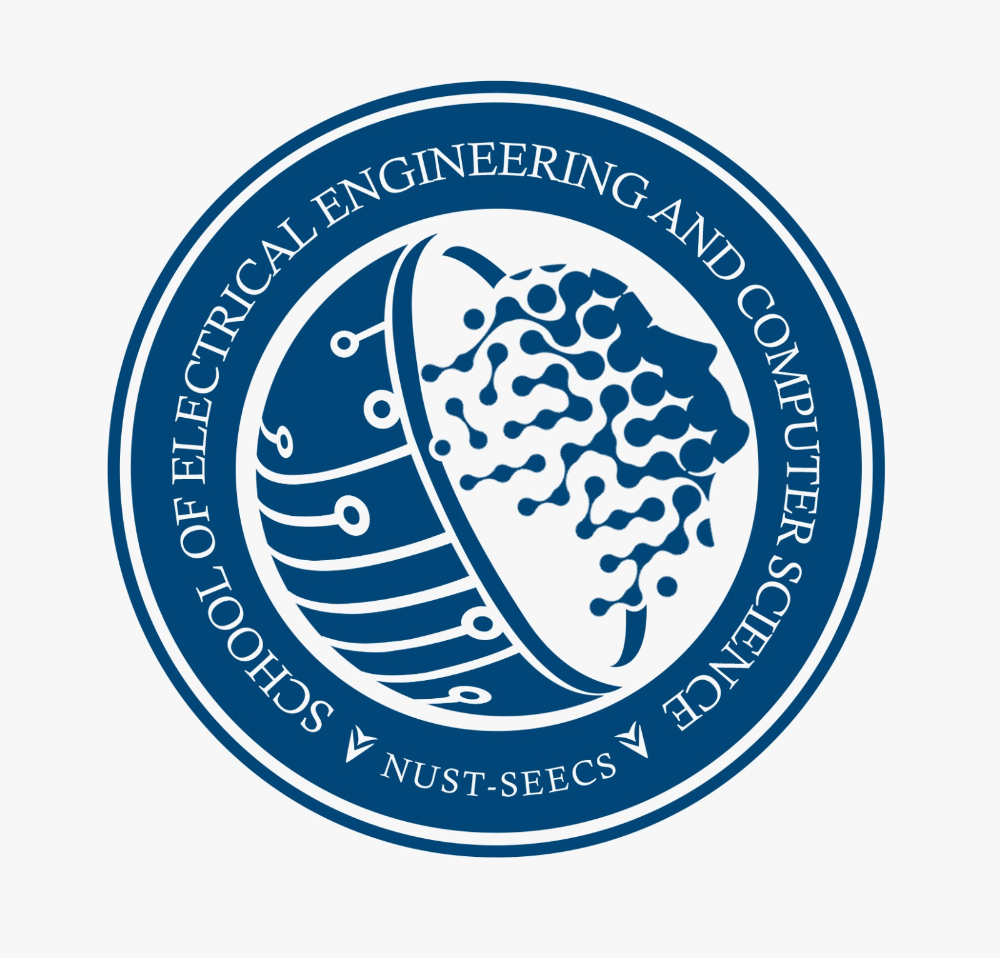

# Learn Your Own X

**Made by NUST students, for NUST students.**

---

>Build small versions of real systems, one module at a time, to understand how they work underneath.

---

Each module is a handout for a live workshop run by GDGoC NUST, and a self-paced guide for anyone else. Every module has starter code that runs on day one, and staged checkpoints you can verify yourself.

Maintained by [Waasila Asif](https://github.com/WaasilaAsif). Workshops run by the GDGoC NUST core team.

**Open discussion is enabled on the GitHub Discussions tab.** Tag any maintainer with an idea or a question.

---

## Modules

| # | Module | You'll build | Domain | Status |
|---|--------|--------------|--------|--------|
| 00 | [Git and GitHub](modules/00-git-and-github/) | Your first merged pull request + a First PR badge on your profile | All | 🟡 In progress |
| 01 | TBD | | | ⚪ Planned |

## How to use this repo

1. Fork this repo, then clone your fork.
2. Pick a module and open its README.
3. Work through the checkpoints in order. Each one tells you how to check that it's done.
4. Stuck? Ask in the help forum on the Discord, tagged with the module name.

## Live cohort

Workshops run every few weeks online on discord or in person, alternating with peer talk sessions. The code here is free for everyone. Cohort registration covers live sessions, help on the Discord, and certificate eligibility.

| Level | How it's earned |
|-------|-----------------|
| First PR | Your first pull request merged (the practice PR in module 00 counts) |
| Module role | Every checkpoint passes on one module |
| Contributor | A module, fix, or improvement merged into this repo |

## Contributing

Want to write a module or fix one? Read [CONTRIBUTING.md](CONTRIBUTING.md).

## Contributors

Everyone who has completed module 00 will be listed in [contributors/](contributors/).

---

**Every destination starts with one small step. Take it.**

