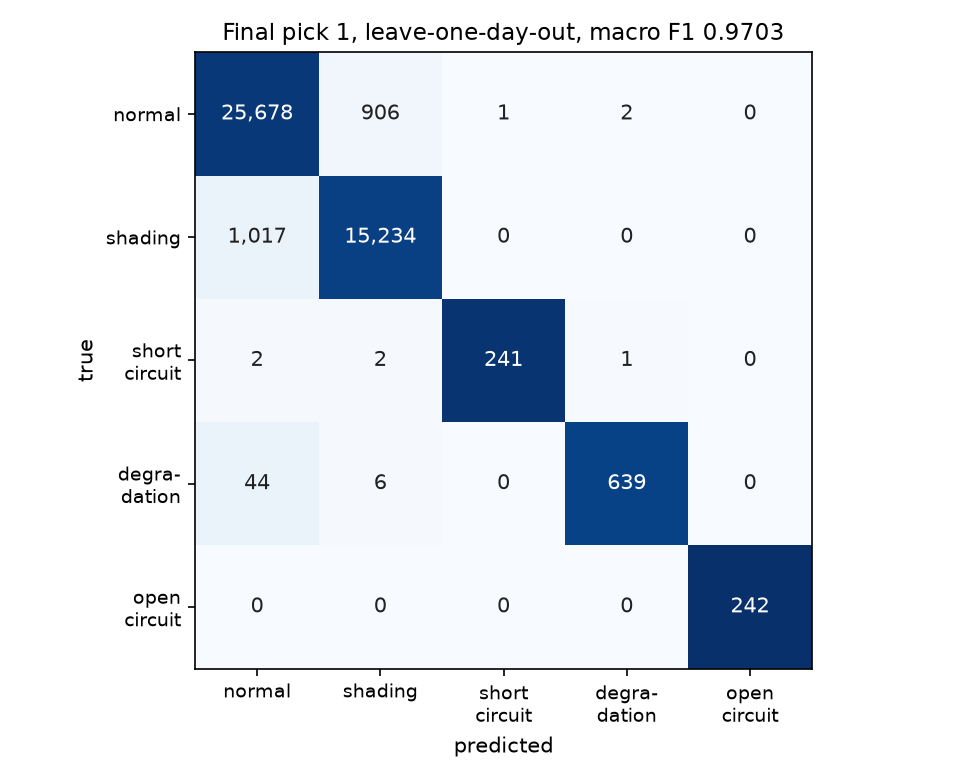

# Team: R.P.D.

- Members (all SEECS, Batch 24):
  - Mohammad Hamza Aslam, CMS 510731 (team lead)
  - Khawaja Muhammad Ali, CMS 532594
  - Mehboob ul Qadri, CMS 515856
  - Mahad Asif, CMS 506968
- Kaggle team name: R.P.D.
- Final Kaggle public score: **0.954**
- Final notebook: [`final_submission.ipynb`](final_submission.ipynb)

## Approach

Voltage and current on their own mostly describe the weather. So we first ask what a healthy plant would produce in the same
sunlight and heat, and then classify how far each reading strays from that. One model separates shading from everything else; a
second, built mostly on voltage, tells normal, short circuit, degradation and open circuit apart.

Two problems shaped the rest. Electrical faults appear on only a handful of days, so we teach the second model with extra faults made
from the wiring itself: bypass two of eight modules in one string and the average voltage must fall to 0.875 of normal, which is
what the real short circuits show (0.870). And the rows are shuffled, but a solar day is not: plotted in (G, T, V, I) it is one smooth
curve, and a reading's nearest neighbours on that curve are seconds away in time. Letting neighbours vote removes much of the noise
at no cost in labels, and knowing where a reading sits on the curve helps with the hardest call, normal against shading.

| Step | What it adds | LODO macro F1 | Kaggle public |
|---|---|---|---|
| Raw sensors, LightGBM | starting point | 0.780 | |
| Physics features | distance from healthy behaviour | 0.875 | |
| Two-stage blend | LightGBM for shading, ExtraTrees for the rest | 0.949 | |
| Synthetic faults | realistic examples of rare classes | 0.954 | 0.942 |
| Shading specialist | second opinion on normal vs shading | 0.956 | |
| Neighbour voting | averages probabilities along the day's curve | 0.968 | 0.950 |
| Three opinions *(final pick 2)* | adds position on the curve, mean of three votes | 0.970 | 0.954 |
| **Distance-weighted voting** *(final pick 1)* | closer neighbours count more | **0.970** | **0.954** |

## Validation

Readings are ten seconds apart, so a random split puts near copies of the same moment in both halves. Our baseline scores 0.992 that
way and 0.875 when a whole day is hidden. The test set is whole unseen days, so we hid one day at a time, trained on the other twelve,
pooled the thirteen sets of predictions and scored them once. Every choice was made on that number, never on the leaderboard.

Two things we checked rather than assumed:

- **Leakage.** No row is scored by a model that saw its own day. The expected-current and expected-voltage features of the training
  days did see the hidden day, though. Rerunning without that costs 0.001 or less (0.9526 instead of 0.9536, 0.9551 instead of 0.9556).
- **Test looks different from one day.** It is several unseen days in a single pile. Scoring hidden days mixed with two others, the final
  model gets 0.9687 to 0.9703, against 0.9680 to 0.9682 for neighbour voting alone. So the last two steps together are worth about
  +0.001 to +0.002.

## Features

| Feature | Why it helps |
|---|---|
| `V_ratio`, `dV_frac`, residuals | Measured over expected voltage. Each fault lands at its own level: open 0.50, short 0.87, degradation 0.95. |
| `R_like` = (V expected − V) / I | Degradation acts like a hidden resistor, so its voltage loss grows with current (about 0.8 Ω, against 0.03 Ω normally). |
| `I_ratio`, `P_ratio` | Shading costs current that the irradiance says should be there. |
| `G_cap` = min(G, 800) | Every real short circuit happened in bright sun; without the cap the model learns "sunny means short". |
| Day-relative T, I and V | Separates a hazy day from a shaded one, using no labels. |
| Position on the curve | Shading repeats a pattern: current ramps down, a flat stretch, a second ramp. One reading cannot tell the stretches apart, its place in the sequence can. |

## Results

Own validation score: **0.9703** (final pick 1), 0.9699 (final pick 2).

| | normal | shading | short | degradation | open |
|---|---|---|---|---|---|
| F1 | 0.963 | 0.940 | 0.988 | 0.960 | 1.000 |

**Normal and shading** account for almost all remaining errors (906 normal called shading, 1,017 the other way). A thin morning shadow and a hazy sky give nearly
the same current, and the moment shading ends moves from day to day. **Degradation read as normal** is next (44 rows), mostly on
day 8, where the fault is mild: voltage sits at 0.956 of expected. Short circuits lose 5 of 246 rows, open circuits none.

**What did not help.** Threshold tuning and prior correction tied or hurt under nested validation. Neural networks trailed the trees
(0.934 at best alone). A sequence network reading the re-ordered day made fewer mistakes on days 9 to 12, but gained too little to justify a training run that does not repeat exactly.
Stacking and similarity-weighted training gave nothing consistent.
Pseudo-labelling nudged the score up and broke day 8, so we dropped it.

## Reproducing

Place the three competition files in `data/`, run `pip install -r requirements.txt`, then `final_submission.ipynb`. It takes
about two minutes on a CPU and writes both submitted files; a fresh run matched both on all 9,617 rows. Only the three
provided files are used, with no external data, no pretrained models and no hand-labelled test rows. Two mislabelled training rows
(3986 and 8152) were removed: they are marked degradation but are electrically open circuits.

## AI and tools used

- **Claude Code (Anthropic)** wrote most of the code, experiments, notebooks and the first draft of this report, including the literature search.
- **What we decided:** we set the direction and asked for a search for patterns in the data, which led to the neighbour
  voting and the position features. We held back the first baseline, approved every upload of this pipeline before it was made, and
  chose the two finals by validation score.
- **AI chats:** all were local Claude Code sessions, so there are no public links.
- Libraries: LightGBM, scikit-learn, SciPy, NumPy, pandas, joblib. Tried and left out: XGBoost, CatBoost, PyTorch, TabICL, pytabkit.
