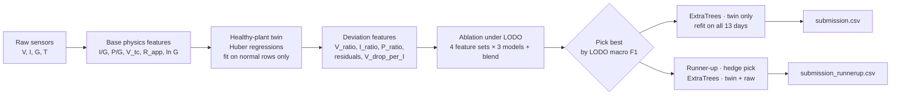

<div align="center">

# ☀️ Team: Tech Titans
### Solar Fault Twin: physics-informed fault diagnosis for a grid-tied solar plant

**Capital Youth Expo Applied AI Challenge** · Qualifying round, GDGoC NUST · 25 November 2026


</div>

---

## 👥 Members

| Name | Role | CMS ID | School | Programme |
|---|---|---|---|---|
| **Esha Shabbir** | Team Lead | 453839 | SEECS, NUST | BS Computer Science |
| **Uswa Khan** | Member | 454092 | SEECS, NUST | BS Computer Science |
| **Abeera Amir** | Member | 468332 | SEECS, NUST | BS Computer Science |

* **Kaggle team name:** Tech Titans
* **Final Kaggle public score:** **0.949** (best submission) · 0.946 (second best submission)

---

## 🧭 Approach

We built a **"digital twin" of the healthy plant**: two robust Huber regressions, fit only on `normal` rows, that predict the voltage and current a *healthy* string should give for the measured sunlight and temperature. Each reading is then described by **how far it departs from healthy behaviour** (voltage ratio, current ratio, implied series resistance), and an **ExtraTrees** classifier works on these deviation features. Because `test.csv` comes from days that are not in training, we validated with **Leave-One-Day-Out (LODO)** cross-validation, refitting the twin inside every fold, and chose the final model automatically from **16 configurations** by LODO macro F1, never by the leaderboard. We chose this because the physics puts each fault in its own region of the deviation space, which carries over to unseen days better than raw sensor values do.

---

## 🛠️ Features we made

**Base physics features**

* **`lnG` = ln(G):** a solar panel's voltage depends on the *log* of irradiance (single-diode model), so this makes the voltage relationship close to linear.
* **`I_per_G` = 1000·I / G:** current per kW/m² stays roughly constant when the string is healthy, so any drop points to shading or lost panels.
* **`P_per_G` = V·I / G:** a performance-ratio proxy that shows total power loss whatever the weather.
* **`V_tc` = V / (1 − 0.0035·(T − 25)):** temperature-corrected voltage, so hot panels aren't mistaken for faulty ones (voltage falls about 0.35 %/°C).
* **`R_app` = V / I:** apparent load resistance, which shifts when panels are shorted or disconnected.

**Digital-twin deviation features** (the core of the model)

* **`V_ratio` = V / V̂:** ≈ 1 when healthy, ≈ 0.88 for short circuit (shorted modules), ≈ 0.5 for open circuit, just below 1 for degradation. This is the main separator of the hardware faults.
* **`I_ratio` = (I/G) / (I/G)^:** ≈ 1 when healthy, < 1 under shading (the shadow hits the panels but not the irradiance sensor), ≈ 0.5 for open circuit.
* **`P_ratio` = V_ratio · I_ratio:** overall power loss compared with a healthy plant in the same conditions.
* **`V_resid` = V − V̂:** absolute voltage gap in volts. It complements the ratio when the voltage is small.
* **`I_resid` = I/G − (I/G)^:** absolute current gap. It helps separate light shading from normal noise.
* **`V_drop_per_I` = (V̂ − V) / I:** **implied series resistance** (from V = I·R). It targets degradation, where worn wiring adds resistance and the voltage drop grows with current.

In the twin's (`I_ratio`, `V_ratio`) plane, open circuit sits near (½, ½), short circuit at V ≈ 0.88, degradation just below 1 on the voltage axis, and shading spreads to the left (lost current).

---

## 📊 Results

* **Our own validation score (LODO macro F1, 13 folds, 44,017 out-of-fold predictions): 0.9321**
* **Kaggle public leaderboard:** **0.949** (best), 0.946 (second)
* **Which faults our model confuses most, and why:**
  * **`degradation` ↔ `normal` is the hardest boundary.** Degradation is the only class below 0.95 F1 (0.798). A small extra series resistance changes the voltage only slightly, so mild degradation looks almost healthy. Its precision (0.76) is lower than its recall (0.84): the balanced class weights make the model flag some healthy rows as degraded rather than miss real degradation.
  * **`normal` ↔ `shading`** gives the most errors by row count, because they are the two largest classes and light shading is a gradual effect with no sharp edge.
  * **Short circuit and open circuit are almost solved** (F1 0.984 and 0.996). Their voltage ratios (≈ 0.88 and ≈ 0.5) are far from healthy, exactly as the physics predicts.

---

## 🤖 AI and tools used

* **Claude (Anthropic):** researching solar PV fault physics (how shading, short circuit, open circuit and series-resistance degradation change V and I); researching validation strategies for test sets from unseen days (grouped / Leave-One-Day-Out CV, adversarial validation); help drafting and debugging notebook code; drafting this report.
* **Libraries:** `numpy`, `pandas`, `scikit-learn` (HuberRegressor, ExtraTreesClassifier, LogisticRegression), `lightgbm`, `matplotlib`.
* **Pretrained models:** none.
* **Compute:** free Google Colab CPU.
* **AI chat links:** not included (optional).

Full details of what AI did and what we changed are in [Section 8](#8--ai-disclosure-in-detail).

---
---

# 📖 Detailed report

## 1. The problem

Each row is one 10-second reading of a small grid-tied solar plant during daylight:

| Signal | Column | Meaning |
|---|---|---|
| `V` | `dc_voltage` | DC string voltage |
| `I` | `dc_current` | DC string current |
| `G` | `irradiance` | Sunlight on the panels (W/m²) |
| `T` | `panel_temp` | Panel temperature (°C) |

We predict one of five states: `normal`, `shading`, `short_circuit`, `degradation` or `open_circuit`. Scoring is **macro F1**, so the three rare hardware faults count as much as `normal`.

**What makes it hard**

* **Severe imbalance.** In training, `normal` is 60.4 % and `shading` 36.9 %, while `degradation` (1.6 %), `short_circuit` (0.56 %) and `open_circuit` (0.55 %) are tiny.
* **Faults cluster in time.** `short_circuit` occurs only on days 11–12, `open_circuit` almost only on days 11–12, and `degradation` on days 8, 9, 11 and 12. Rows from one fault episode are strongly correlated.
* **Day shift.** `test.csv` comes from days that are not in `train.csv`.
* **A dangerous shortcut.** In training, hardware faults appear only at high irradiance. A model on raw values can learn "low sunlight ⇒ never a fault", which may not hold on new days.

Dataset size: **44,017 training rows** over **13 days**, and **9,617 test rows**.

---

## 2. Pipeline



### 2.1 Physics first: how each fault shows up

In a healthy PV string, current follows irradiance (I ∝ G) and voltage falls as temperature rises (about −0.35 %/°C). Each fault breaks this relationship in its own way:

| State | What physically happens | Signature we expect |
|---|---|---|
| `normal` | Everything works | V and I/G match the healthy model |
| `shading` | Shadow on panels, but not on the irradiance sensor | Current per unit irradiance **drops**, voltage rises |
| `short_circuit` | Two panels shorted together | Voltage drops by the share of shorted modules (**≈ 12 %**), current unchanged |
| `degradation` | Extra resistance between panels (worn wiring) | Small voltage drop that **scales with current** (V = I·R) |
| `open_circuit` | One group of panels disconnected | Voltage **and** current both fall to **about half** |

This table drove our feature design: rather than asking a model to learn physics from raw numbers, we compute the quantities the physics says should separate the classes.

### 2.2 The healthy-plant digital twin

Using **`normal` rows only**, we fit two **Huber regressions** (robust to outliers):

$$\hat V = f(\ln G,\ T) \qquad \widehat{I/G} = g(\ln G,\ T)$$

with terms $[\ln G,\ T,\ (\ln G)^2,\ \ln G \cdot T]$. The log of irradiance comes from single-diode-model intuition: open-circuit voltage depends on ln G and T.

**Leakage control:** inside cross-validation, the twin is **refit on each training fold**, so the held-out day never influences its own features.

---

## 3. How we validated

The organisers warned that a model can look great on a random split and still fail on new days. So we never used a random split for any decision.

**Leave-One-Day-Out (LODO), 13 folds**

1. Hold out one whole day.
2. Refit the **twin** and the **classifier** on the other 12 days.
3. Predict the held-out day.
4. After all 13 folds, compute **macro F1 on the pooled out-of-fold predictions**.

We pool because a single day usually doesn't contain all five classes, so a per-day macro F1 would be undefined. LODO mirrors the test situation: every prediction is made for a day the model has never seen.

**Model selection is automatic.** The notebook picks the configuration with the highest LODO macro F1 (`best_key = max(OOF, key=...)`). The leaderboard was used only to confirm that uploads were valid, never to tune.

---

## 4. Results in detail

### 4.1 Ablation: 16 configurations, all under LODO

| Features ↓ / Model → | LogReg | LightGBM | **ExtraTrees** | LGBM + LogReg blend |
|---|---:|---:|---:|---:|
| raw (4 sensors) | 0.7078 | 0.7517 | 0.8258 | 0.8413 |
| raw + ratios | 0.7649 | 0.8014 | 0.9138 | 0.8193 |
| **twin only** | 0.7046 | 0.8468 | **🏆 0.9321** | 0.8827 |
| twin + raw | 0.7635 | 0.8299 | 0.9190 | 0.8477 |

**What the ablation tells us**

* **Physics features matter most.** For ExtraTrees, going from raw sensors to twin features lifts LODO macro F1 from **0.826 → 0.932** (+0.106). The gain is largest on the hard classes: degradation **0.618 → 0.798**, short circuit **0.708 → 0.984**.
* **Less is more.** *Twin only* beats *twin + raw*. Adding raw V, I, G back lets the model use weather-dependent shortcuts that don't carry over to new days.
* **ExtraTrees wins clearly.** Its randomised splits and averaging generalise better across days than boosting here; LightGBM fits the training days more tightly.

### 4.2 Final model: ExtraTrees on twin-only features

Hyperparameters: 80 trees, `min_samples_leaf=5`, `max_features=0.6`, `class_weight="balanced"`, `random_state=42`.

Twin-only feature set: `V_ratio`, `I_ratio`, `P_ratio`, `V_resid`, `I_resid`, `V_drop_per_I`, `lnG`, `T`.

**LODO classification report (44,017 out-of-fold predictions)**

| Class | Precision | Recall | F1 | Support |
|---|---:|---:|---:|---:|
| normal | 0.9629 | 0.9412 | 0.9519 | 26,587 |
| shading | 0.9165 | 0.9466 | 0.9313 | 16,251 |
| degradation | 0.7625 | 0.8365 | 0.7978 | 691 |
| short_circuit | 0.9917 | 0.9756 | 0.9836 | 246 |
| open_circuit | 0.9918 | 1.0000 | 0.9959 | 242 |
| **macro avg** | **0.9251** | **0.9400** | **0.9321** | 44,017 |

Accuracy: **0.9421**.

### 4.3 Kaggle submissions (our 2 final picks)

| Pick | Configuration | LODO macro F1 | Public LB |
|---|---|---:|---:|
| **Main** | ExtraTrees · twin only | 0.9321 | **0.949** |
| **Hedge** | ExtraTrees · twin + raw (LODO runner-up) | 0.9190 | 0.946 |

* The **ranking matches**: the LODO winner also scored best on the public leaderboard, and the runner-up came second. This suggests our day-grouped validation is a faithful guide to the test set.
* The public scores are **about 0.02–0.03 higher than LODO**. LODO is the stricter test: it includes held-out days where a fault was very rare in the remaining training days, while the test days have plenty of each fault (Section 4.4).
* The two picks agree on **98.18 %** of test rows. We chose the runner-up as a hedge because it is the next-best configuration by LODO, not because of its leaderboard score.

### 4.4 Predicted class mix on the test set (main pick, 9,617 rows)

| Class | Train share | Test predicted share | Test rows |
|---|---:|---:|---:|
| normal | 60.40 % | 57.62 % | 5,541 |
| shading | 36.92 % | 31.18 % | 2,999 |
| degradation | 1.57 % | 3.68 % | 354 |
| short_circuit | 0.56 % | 3.77 % | 363 |
| open_circuit | 0.55 % | 3.74 % | 360 |

The model predicts roughly **6–7× more** short and open circuits on the test set than the training rate. The three hardware faults come out at almost the same count (354–363 rows each), which suggests the test days contain deliberately balanced fault episodes. Because the twin features are ratios rather than raw values, the model can flag these faults without relying on how often they appeared in training.

The full row-normalised confusion matrix is in Section 5 of the notebook.

---

## 5. Overfitting and robustness checks

| Check | What we did | What we found |
|---|---|---|
| **Learning curves** (6.1) | Train vs held-out multi-log-loss per LODO fold as LightGBM trees are added | Held-out log-loss is lowest at **~119 rounds** (0.184) and only slightly higher at the chosen 300 (0.210), so boosting overfits a little past ~120 rounds |
| **More training days** (6.2) | Held-out macro F1 on fault days 11/12 while training on 2 → 11 days, 3 repeats | Score rises with more days and flattens out: no sign of underfitting |
| **Seed stability** (6.3) | LightGBM LODO over 3 seeds | 0.8595 / 0.8659 / 0.8468, **std 0.0079**: results are stable |
| **Irradiance robustness** (6.3) | LODO accuracy per irradiance bin | Bar chart in the notebook, checks the low-sunlight shortcut |
| **Adversarial validation** (6.4) | Classifier to tell train rows from test rows | AUC **0.98 (raw)** and **0.99 (twin only)**: the test days are very easy to tell apart from training days |
| **Feature importance** (7) | LightGBM gain on twin features | Twin deviation features dominate |

**Reading the adversarial result honestly:** we expected the twin features to reduce the train/test shift, and they did not. Both feature sets separate train from test almost perfectly. The likely reason is that `lnG` and `T` (weather) are still in the twin feature set, and the test set has a very different fault mix (Section 4.4), which itself shifts `V_ratio` and `I_ratio`. This is the strongest reason we trusted only day-grouped validation and did not tune anything to the leaderboard. The public score (0.949) confirms that the twin model still generalises well despite this shift.

---

## 6. Reproducing our score

```bash
pip install numpy pandas matplotlib scikit-learn lightgbm
```

1. Put `train.csv` and `test.csv` in one of: `/kaggle/input/gdgoc-cye-ai-2026`, `/content` (Colab) or the notebook's own folder. The notebook finds them automatically.
2. Run all cells. The whole notebook runs on a free Colab CPU in a few minutes.
3. Outputs: `submission.csv` (main pick, public LB 0.949) and `submission_runnerup.csv` (hedge pick, public LB 0.946).

`SEED = 42` is fixed everywhere. The last cell (`google.colab.files.download`) only works in Colab; skip it on Kaggle or locally.

---

## 7. Limitations and what we'd do next

* **Diagnostics use LightGBM, the final model is ExtraTrees.** The learning-curve and seed-stability checks (6.1, 6.3) were written before ExtraTrees won the ablation. With more time we'd repeat them for ExtraTrees (a seed sweep over `random_state`, and a curve over the number of trees).
* **Random-split comparison (Section 3 of the notebook).** While writing this report we found that the random 5-fold cell maps `cross_val_predict` probability columns (sorted alphabetically) to our class order (`CL`) without reordering, so its printed scores (≈ 0.004) are invalid. Our LODO numbers are not affected, because `lodo_oof` reorders the columns explicitly.
* **Degradation is the weak spot.** A per-day voltage baseline or a short rolling window over consecutive readings could expose the slow, current-dependent voltage drop better.
* **Threshold tuning.** Macro F1 could gain from per-class probability thresholds tuned on the LODO out-of-fold predictions (not the leaderboard).

---

## 8. 🤖 AI disclosure in detail

AI tools were allowed and encouraged in this round. We used them openly and are listing exactly how.

| Part | AI's contribution | Our contribution / changes |
|---|---|---|
| Fault physics research | Explained the electrical signature of each fault type | We turned it into the twin design and chose which ratios to compute |
| Validation strategy | Suggested grouped CV for a day-shifted test set | We chose Leave-One-Day-Out, pooled OOF macro F1, and refitting the twin inside each fold to avoid leakage |
| Notebook code | Drafted feature, twin, CV and plotting code | We ran, checked and debugged it; cut ExtraTrees from 150 → 80 trees and LogReg `max_iter` 3000 → 500 so the full ablation fit inside the 3-hour round |
| Model selection | — | We decided to select by LODO only and never by the leaderboard, and to submit the LODO runner-up as our hedge pick |
| Result checking | Helped review the outputs while writing this report | We read every result, kept the ones that disagreed with our expectations (adversarial AUC) and reported them honestly |
| Report | Drafted structure and text from our notebook and outputs | We reviewed and edited it and added our leaderboard scores |

All modelling decisions were made by the team, and every number in this report comes from our notebook's own outputs and our Kaggle submissions.

---

## 📁 Files

```
tech-titans/
├── Tech-Titans.md                            ← this report
└── tech_titans_solar_fault_twin.ipynb        ← full notebook (reproduces submission.csv)
```

<div align="center">

**Tech Titans** · Esha Shabbir (Team Lead) · Uswa Khan · Abeera Amir
*SEECS, NUST · Built in 3 hours at SEECS, NUST H-12*

</div>
